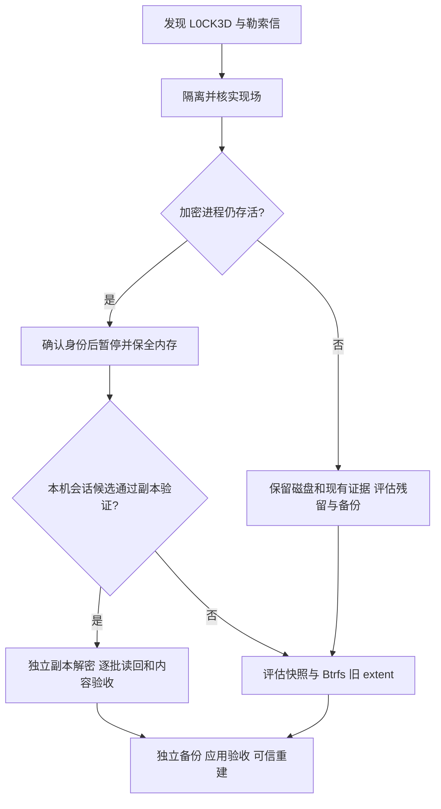

# C3RB3R / .L0CK3D：群晖 DSM 勒索恢复实录

简体中文 | [English](README_EN.md)

**从暂停仍存活的加密进程，到验证本机会话材料、恢复照片与实况配对，再到几十万文件的分包验收。** 这是一次 i3-8100T 裸机 DSM 受灾后的个人恢复记录，也是一套围绕“保留原件、检查副本、逐批验收”整理的操作参考。**救援电脑可使用 Windows、macOS 或 Linux；本案实际使用 Mac，不代表恢复流程仅适用于 Mac。**

照片范围已生成 **63,667 份恢复输出、约 98.06 GB**，其中主照片与视频为 **9,423 份**；完成 **3,727 对实况资源**配对。另一个共享目录与六个小目录已完成文件恢复。`homes` 截至 **2026-10-31 16:08（UTC+08:00，资料截点）**累计 **73,094 个文件通过文件级验收**，`homes-0009` 在处理中。**全 NAS、应用恢复、独立备份与系统可信重建仍未完成。**

> 新受灾现场应先隔离和核实加密进程，尽早保全易失证据。不要为安装工具先重启、升级、重装或强杀加密进程。恢复输出优先写到独立设备；本案后期写回同一 NAS 新目录是受容量约束的实际选择，存在风险，不能视为推荐备份架构。

## Windows、macOS 与 Linux 怎么使用

NAS 端的进程保全、密文格式、候选验证及恢复验收原则，与救援电脑操作系统无关。附带的 Python 审计工具已做三平台适配；本次只在 macOS 实测，Windows/Linux 的远端 CI 尚待运行。

网络命令、路径、权限和媒体 API 需要按平台替换。本案 `en7`、`route`、`tcpdump`、`.command` 和 Apple `PHLivePhoto` 调用属于 Mac 操作记录；Windows 不能逐行照抄，也不能把 Apple 资源构建结果当作 Windows 已验证。见[跨平台使用指南](docs/11-cross-platform.md)。

## 这份仓库的价值

- 记录 Mac 双网络下 `Cannot allocate memory` 的实际定位：抓包显示 TCP 未发出，撤销临时静态主机路由后恢复；并非 NAS 内存不足。
- 记录两次进程采集都有 **12,288 字节缺页**时，怎样保留 `PARTIAL_HOLES` 标识，继续离线验证，而不宣称得到完整 RAM。
- 说明为什么默认尾标记拒绝发生在密钥检查之前，以及如何依据本案 `e921db3b` profile 和精确原件验证适配，保留长度、模式和记录检查。
- 记录大小写合并、权限遗漏、全量输出 SHA、实况内部标识错配、媒体解码例外和 `.DS_Store` 新旧版本冲突。
- 记录中断时 NAS 有 1,817 条回执、Mac 仅确认 1,816 条的续接问题，以及改为按归档包处理后的验收边界。

## 已做到了哪里

| 范围 | 结果 | 验证边界 |
|---|---:|---|
| 进程采集 | 两份 v2，19 个映射摘要通过 | 每份仍缺 12 KiB；不是整机镜像 |
| photo 密文恢复 | 63,667 份 / 98,064,905,843 字节 | 全量读回 SHA；仅 4 份与精确历史原件 SHA 一致 |
| 主照片与视频 | 9,423 份 | 其余主要为缩略图、索引等，不能全称照片 |
| 实况照片 | 3,727 对 / 7,454 个派生副本 | 76 项缺伴；不再计为新增恢复原件 |
| 共享目录 | 1,341 份：1,288 解密、53 复制 | 无精确历史原件对照，应用未验收 |
| 六个小目录 | 321 份：225 解密、96 复制 | 12 组冲突保留双方，1 份 JSON 格式例外 |
| homes | 累计 73,094 份文件级验收 | 0008 已验收，0009 进行中；整体未完成 |
| Docker / 数据库 / 稀疏虚拟盘 | 专项待办 | 不能直接扩大普通照片恢复工具使用范围 |

统计包含不同基线和不同性质的对象，不简单相加为“已救回照片总数”。详细依据和时间修订见[结果与局限](docs/07-results-and-limits.md)。

## 先选路线



本案实际使用**进程内存取钥路线**。Btrfs 路线仅做文献与工具比较，本案没有运行 extent 恢复，也没有 Btrfs CRC32C 恢复验收结果。

## 从这里开始阅读

| 需要了解 | 文档 |
|---|---|
| Windows / macOS / Linux 的命令与平台边界 | [11 · 跨平台指南](docs/11-cross-platform.md) |
| 新受灾现场的顺序与停止条件 | [00 · 操作路线](docs/00-runbook.md) |
| 我的事件背景、日期与完整历史 | [01 · 事件记录](docs/01-incident-report.md) |
| 网络与 SSH/SCP（含 Mac 现场记录） | [02 · 网络与传输](docs/02-network-and-transfer.md) |
| 暂停进程、流式采集、缺页 | [03 · 内存保全](docs/03-memory-preservation.md) |
| 候选、尾标记与单文件验证 | [04 · 密钥与格式](docs/04-key-and-format.md) |
| 照片清单、实况配对、解码 | [05 · 照片与 Live Photo](docs/05-photo-and-live-photo.md) |
| 原件归档、冲突与分包续跑 | [06 · 分目录恢复](docs/06-batch-recovery.md) |
| 最新进度、数字与不能声称的结论 | [07 · 结果与局限](docs/07-results-and-limits.md) |
| 三个参考仓库与 Btrfs 备选路线 | [08 · 参考路线比较](docs/08-btrfs-and-references.md) |
| 入侵入口与可信系统重建 | [09 · 安全与重建](docs/09-security-and-rebuild.md) |
| 对话分析、证据优先级与来源提交 | [10 · 来源与修订](docs/10-source-review.md) |
| 原始分享报告的脱敏历史版 | [完整历史报告](docs/full-process-report.md) |

## 本仓库附带什么工具

[tools/rescue_audit.py](tools/rescue_audit.py) 是新编写的 Python 3.9+ 标准库离线工具，提供目录清单、逐路径 SHA 比对、588 字节 EOF 布局检查，以及大小写/Unicode/明密文重名的输出对象规划。不会连接 NAS、提取密钥、解密、读取块设备或修改源文件。

```sh
# macOS / Linux
python3 tools/rescue_audit.py --help
python3 -m unittest discover -s tests -v
```

Windows PowerShell 使用 `py -3` 替换上面的 `python3`；完整示例见[跨平台指南](docs/11-cross-platform.md)。

完整命令和限制见[工具说明](tools/README.md)。实际使用过的采集器、解密器和本案固定路径控制器在文档中说明来源及限制；未将它们直接复制为通用工具。上游开源许可、版本和适配范围仍需分别核对。

## 交给管理员或 AI 的任务说明

> 阅读 README、操作路线和验证边界。先确认设备类型、重启历史、加密活动、可信管理通道及独立存储。在已授权范围内阻止损失，优先保全易失证据；先验证独立密文副本和精确原件，再决定批量。不要照抄本案 PID、接口、会话标记或私有路径。遇到源变化、缺页、未知 footer、冲突、容量不足和无回执输出，停止依赖该条件的批次并保留证据。区分传输 SHA、输出 SHA、历史原件 SHA、解码及应用验收。不要执行恢复出的程序，也不要把恢复数据成功称为感染清除。

## 来源、隐私与许可

参考 [soimy/c3rb3r-rescue](https://github.com/soimy/c3rb3r-rescue)、[sunkangbo121-ship-it/c3rb3r-btrfs-extent-rescue](https://github.com/sunkangbo121-ship-it/c3rb3r-btrfs-extent-rescue)、[crt106/c3rb3r-btrfs-recovery](https://github.com/crt106/c3rb3r-btrfs-recovery)。固定提交与差异见[来源审阅](docs/10-source-review.md)。他们的设备、恢复量和漏洞结论没有记作我的经历。

仓库不包含内存、会话密钥、密文、恢复媒体、凭据 JSON 或私人原始聊天。示例地址经过替换；样本摘要及四字节会话标记用于解释兼容性，不是解密密钥。提问前阅读 [SECURITY.md](SECURITY.md)。本仓库原创内容使用 [MIT](LICENSE)，第三方代码未随仓库分发。
